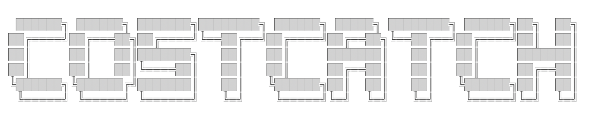
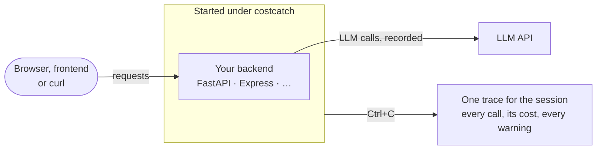
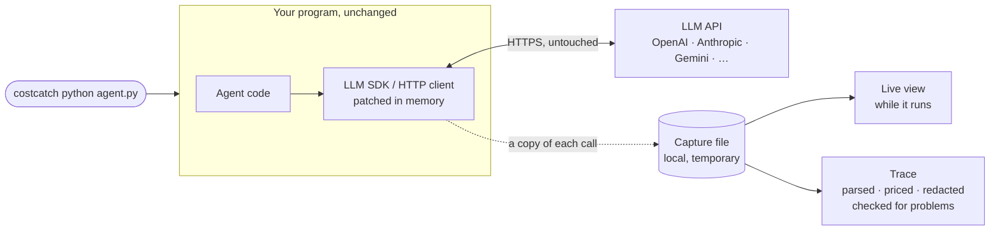

<div align="center">



### See what your AI agent did, what it cost, and where it went wrong.

**Put `costcatch` in front of the command that runs your agent.<br>Nothing to add to your code, nothing to sign up for, and nothing leaves your machine.**

[](https://www.npmjs.com/package/costcatch)
[](https://opensource.org/licenses/MIT)
[](https://nodejs.org)
[](https://github.com/RonakRahane/costcatch/actions/workflows/ci.yml)

```bash
costcatch python my_agent.py
```

</div>

---

## Contents

- [Why costcatch](#why-costcatch)
- [Install](#install)
- [Quick start](#quick-start)
- [Trace a whole app](#trace-a-whole-app)
- [How it works](#how-it-works)
- [What you see](#what-you-see)
- [What it catches](#what-it-catches)
- [Commands](#commands)
- [Use it in CI](#use-it-in-ci)
- [Supported providers](#supported-providers)
- [What is exact and what is estimated](#what-is-exact-and-what-is-estimated)
- [Your data](#your-data)
- [Privacy and security](#privacy-and-security)
- [Configuration](#configuration)
- [Troubleshooting](#troubleshooting)
- [Limitations](#limitations)
- [Contributing](#contributing)

---

## Why costcatch

An AI agent is a loop. Every turn it sends the whole conversation to a model,
runs the tools the model asks for, adds their results, and goes again. Both the
cost and the bugs hide in that loop:

- **Costs add up quietly.** The history is sent again on every turn, so one big
  tool result is paid for on every call after it. A silent retry, or an agent
  stuck repeating itself, multiplies the bill.
- **Failures hide.** The SDK retries a rate limit without telling you. A tool
  fails and the model works around it. An answer gets cut off at `max_tokens`.
  The run still "finishes", and all you see is the final answer.
- **Your provider's dashboard can't help.** It shows a daily total per model. It
  can't tell you which step of which run, which tool, or why.
- **Most tracing tools need setup first.** You wrap your client in their SDK,
  send your traffic through their proxy, or upload your prompts to their cloud.

costcatch runs your agent and records every LLM API call it makes, from outside
your code. While the agent runs, each call shows up live in your terminal. When
it ends, you get the whole run step by step: the model, tokens and cost of each
call, the tools the model asked for and how big their results were, what failed
and why, and warnings that point at what to fix.

| Question | Where costcatch answers it |
|---|---|
| Which step failed, and why? | ✗ rows with the HTTP status and the provider's message, and failed tools with their error |
| Which step costs the most? | The cost of every step, with a bar, and a warning when one step costs more than the rest together |
| Which tool result is bloating every prompt? | The size of every tool result, and a warning for big results sent again and again |
| Did the agent loop, retry, or get cut off? | Loop, retry, duplicate and cut-off warnings |
| Where did the time go? | Time in LLM calls against time in your own code and tools |
| Did my change make it worse? | `diff`, `--compare-last`, and CI gates on cost, calls and errors |

How it compares:

| Approach | Examples | What it asks of you |
|---|---|---|
| SDK-based tracing | LangSmith, Langfuse, Braintrust | Add their SDK to your code and send traces to their server |
| Proxies and gateways | Helicone, LiteLLM Proxy | Point your API base URL at the proxy |
| OpenTelemetry | OpenLLMetry, APM vendors | Add instrumentation and run a collector |
| **costcatch** | | **Put `costcatch` in front of your command** |

costcatch is a tool for the machine you're developing on. It isn't production
monitoring, and it works fine next to any of the tools above.

---

## Install

The published npm package, v0.1.0, runs on Node.js 18.17 or later. Building and
testing from this repository requires Node.js 20.19 or later. To trace Python
agents you also need Python 3.8 or later; there's nothing to `pip install`.

```bash
npm install -g costcatch
costcatch init        # once: downloads current prices for every model
```

Or run it without installing: `npx costcatch python my_agent.py`.

To build it from source:

```bash
git clone https://github.com/RonakRahane/costcatch.git
cd costcatch
npm ci
npm run build
npm link              # puts the costcatch command on your PATH
```

---

## Quick start

```bash
costcatch init                  # first, once: download current prices for every model
costcatch python my_agent.py    # trace a Python agent
costcatch node my_agent.js      # trace a Node.js agent
```

Run `costcatch init` before your first trace, and again now and then to pick up
new prices. Without it, costcatch only knows a small bundled price list, so
newer models show `$?.??`, and costcatch reminds you to run it.

### The `init` screen

This is the full terminal screen from `costcatch init`. It was captured on
November 18, 2026; the fetched model count changes as the public price lists are
updated.

```text
 ██████╗ ██████╗ ███████╗████████╗ ██████╗ █████╗ ████████╗ ██████╗██╗  ██╗
██╔════╝██╔═══██╗██╔════╝╚══██╔══╝██╔════╝██╔══██╗╚══██╔══╝██╔════╝██║  ██║
██║     ██║   ██║███████╗   ██║   ██║     ███████║   ██║   ██║     ███████║
██║     ██║   ██║╚════██║   ██║   ██║     ██╔══██║   ██║   ██║     ██╔══██║
╚██████╗╚██████╔╝███████║   ██║   ╚██████╗██║  ██║   ██║   ╚██████╗██║  ██║
 ╚═════╝ ╚═════╝ ╚══════╝   ╚═╝    ╚═════╝╚═╝  ╚═╝   ╚═╝    ╚═════╝╚═╝  ╚═╝


┌────────────────────────────────┬────── v0.1.0 ───────────────────────────────────────┐
│                                │                                                     │
│ About                          │ Commands                                            │
│ Zero-instrumentation LLM       │   run          trace a script (default)             │
│ agent tracer & cost tracker.   │   estimate     estimate prompt token cost           │
│ Like `time`, for AI agents.    │   show         inspect conversation content         │
│                                │   diff         compare two saved traces             │
│ Features                       │   stats        aggregated analytics                 │
│ · live trace in the terminal   │   replay       re-display a saved trace             │
│ · per-call cost tracking       │   watch        run, always saved                    │
│ · prompt cost estimation       │   clean        prune old saved traces               │
│ · auto-diff between runs       │   init         setup & fetch pricing                │
│ · CI assertion gates           │                                                     │
│ · secret & PII redaction       │ Quick Start                                         │
│                                │ $ costcatch python3 agent.py                        │
│                                │ $ costcatch node agent.mjs                          │
│                                │                                                     │
└────────────────────────────────┴─────────────────────────────────────────────────────┘


- fetching latest model pricing…

┌──────────────────────────────────────────────────────────────────────────────────────────────┐
│ costcatch                                                                               init │
│                                                                                              │
│ ✓ created .costcatch/ (~/oncall-agent/.costcatch)                                            │
│ ✓ added .costcatch/ to .gitignore                                                            │
│ ✓ fetched latest pricing (5,831 models)                                                      │
│                                                                                              │
│ ready · run `costcatch --help` to see all commands                                           │
└──────────────────────────────────────────────────────────────────────────────────────────────┘
```

Your program runs as usual and keeps its own output and exit code. costcatch
draws a live view of the calls under that output, and prints the full trace when
the program exits.

### Try it without an API key

The repository has a small demo agent that answers its own API calls from a
mock server in the same process. It needs no key and calls no real API, and
costcatch prices its calls as if they went to `gpt-4o`. From the repository root:

```bash
costcatch node demo_scripts/demo_agent.mjs

costcatch --save node demo_scripts/demo_agent.mjs      # save a run
costcatch --save node demo_scripts/demo_agent_v2.mjs   # save a cheaper version of the same agent
costcatch diff                                         # compare the two saved runs
```

### What to try next

```bash
costcatch --save python my_agent.py                 # keep the trace in .costcatch/
costcatch show --step 3                             # read exactly what step 3 sent and got back
costcatch --save --compare-last python my_agent.py  # what changed since the last run
costcatch stats                                     # spend and tools across all saved runs
costcatch --max-cost 0.10 --max-errors 0 python my_agent.py   # fail if it costs too much or errors
```

> **costcatch's own flags go first.** Like `time` and `env`, everything from
> your program's name onward belongs to your program. `costcatch --save python
> agent.py` saves the trace; `costcatch python agent.py --save` passes `--save`
> to your agent. costcatch warns you when one of its flags ends up in your
> command.

---

## Trace a whole app

costcatch isn't limited to scripts. Start your backend under costcatch, use your
app the way you normally would (a browser, your frontend, `curl`), and every LLM
call any request makes shows up in the live view. Press Ctrl+C to stop the
server, and costcatch prints the trace of the whole session. Add `--save` to
keep it.



**Node.js.** Express, Fastify or a plain `http` server all work the same way:

```bash
costcatch node server.js                   # start the server under costcatch
costcatch --save node --watch server.js    # restarts on file changes stay in one trace
costcatch --save npx tsx src/server.ts     # a TypeScript server, through tsx
```

costcatch needs to see `node`, `npx`, `tsx` or `ts-node` in the command, so
`costcatch npm run dev` stops with "Could not detect runtime". Use the command
from your `dev` script instead, for example `costcatch node --watch src/server.js`.

**FastAPI.** Start uvicorn or the FastAPI CLI through `python -m`:

```bash
costcatch python -m uvicorn main:app --reload        # also works with --workers
costcatch python -m fastapi dev main.py              # the FastAPI CLI
costcatch -- uv run python -m uvicorn main:app       # in a uv project
```

`costcatch uvicorn main:app` doesn't work, because costcatch needs to see
`python` in the command. `python -m uvicorn` starts the same server. Reloads and
worker processes land in the same trace.

A few things to know about a session trace:

- Calls are numbered in the order they started, across every request.
- Warnings that compare calls treat the session as one run. Two requests that
  send the same prompt show as a retry.
- `costcatch show --grep "<text>"` finds the calls one request made.
- `--budget 1.00` stops the server once the session has spent $1.00.
- A long session can hit the capture limit (64 MiB). Raise
  `COSTCATCH_MAX_TRACE_BYTES` to record more.

---

## How it works



1. **costcatch starts your program with a small interceptor loaded.** For
   Node.js it patches `http`, `https` and `fetch`, and it also reaches programs
   started through `npx` or `tsx` and any Node workers your program starts. For
   Python it patches `httpx`, `httpx2` and `urllib3`, which covers `requests`,
   the OpenAI, Anthropic and Mistral SDKs, LangChain, LiteLLM and CrewAI.
2. **The interceptor copies each LLM call** (the URL, the request, the response,
   the status and the timing) into a temporary file on your machine. Streamed
   responses are put back together from their events.
3. **costcatch reads that file while the program runs** to draw the live view.
   When the program exits, it builds the trace: each call is read, priced,
   redacted, linked to its tool results, and checked for problems.

The interceptor only watches. If something inside costcatch fails, it records
nothing; it never breaks your agent. Your program reads its responses as usual,
errors stay yours, and memory use is capped (2 MiB per response and 64 MiB per
run by default). Request headers are never read, so your API keys never end up
in a trace.

**How it knows about your tools.** costcatch only sees HTTP traffic, but every
tool result has to go back to the model inside the next request, tagged with the
id of the call it answers. costcatch matches the two by that id. That's how it
knows how big each result was, which tools failed, and which results were sent
again on every later call. It never guesses: a tool counts as failed only when
the API itself marks the result as an error.

---

## What you see

The examples below are real costcatch output from a demo research agent run
against a local mock API. The run hits most of what goes wrong in practice: a
big file read, a tool that keeps failing, a rate limit, an answer cut off at
`max_tokens`, and a crash before a tool result went back to the model.

### While it runs

A live box sits under your program's own output and redraws in place. Calls in
flight show a spinner and a timer. Finished calls settle in with their tokens
and cost, and a failed tool turns ✗ as soon as the next call reports it.

```
┌──────────────────────────────────────────────────────────────────────────────────────────────┐
│ ▸ costcatch                                                                     10.4s  $0.03 │
│                                                                                              │
│ ✓ Step 1 claude-sonnet-4-20250514    1.2s     43 tok in → 60 tok out  $0.00103               │
│    ├─ ▸ read_file(path="big.log")  → ~4.3k tok                                               │
│    └─ ✗ get_weather(city="Atlantis")                                                         │
│         failed: WeatherAPIError: city 'Atlantis' not found                                   │
│ ✓ Step 2 claude-sonnet-4-20250514    2.4s  4,142 tok in → 60 tok out     $0.01               │
│    └─ ✗ get_weather(city="Atlantis")                                                         │
│         failed: WeatherAPIError: city 'Atlantis' not found                                   │
│ ✗ Step 3 claude-sonnet-4-20250514   312ms  HTTP 429                                          │
│    └─ rate_limit_error Number of request tokens has exceeded your per-minute rate limit      │
│ ✓ Step 4 claude-sonnet-4-20250514    2.1s  4,213 tok in → 60 tok out     $0.01               │
│    └─ ▸ get_weather(city="Atlantis")                                                         │
│ ▖ ··     claude-sonnet-4-20250514    2.5s  thinking..                                        │
│                                                                                              │
│ 5 calls · 8.4k tok in → 180 tok out · $0.03 · 3 errors                                       │
└──────────────────────────────────────────────────────────────────────────────────────────────┘
```

The box fits your window and keeps working when you resize it, including inside
task runners such as turborepo. When it fills the window, the oldest steps move
up into your scrollback and one row at the top adds them up, so no step is ever
lost. If another process writes to the same terminal, costcatch prints one line
per call instead and tells you which process it is.

### When it finishes

The live box is replaced by the full trace: every step, a summary, and the
warnings, worst first.

```
┌──────────────────────────────────────────────────────────────────────────────────────────────┐
│ costcatch                                          claude-sonnet-4-20250514  ·  17.2s  $0.10 │
│                                                                                              │
│ ✓ Step 1   1.2s    400 tok in → 60 tok out  $0.00210  ▒░░░░                                  │
│    ├─ ▸ read_file(path="big.log")  → ~5.4k tok                                               │
│    └─ ✗ get_weather(city="Atlantis")                                                         │
│         failed: WeatherAPIError: city 'Atlantis' not found                                   │
│                                                                                              │
│ ✓ Step 2   2.4s  7,500 tok in → 60 tok out     $0.02  ████▓                                  │
│    └─ ✗ get_weather(city="Atlantis")                                                         │
│         failed: WeatherAPIError: city 'Atlantis' not found                                   │
│    ∆ context grew 18.8× (400 → 7,500 input tok)                                              │
│                                                                                              │
│ ✗ Step 3  305ms  HTTP 429                                                                    │
│    └─ rate_limit_error Number of request tokens has exceeded your per-minute rate limit      │
│                                                                                              │
│ ✓ Step 4   2.1s  7,700 tok in → 60 tok out     $0.02  ████▓                                  │
│    →→ retry of step 3                                                                        │
│    └─ ✗ get_weather(city="Atlantis")                                                         │
│         failed: WeatherAPIError: city 'Atlantis' not found                                   │
│                                                                                              │
│ ∆ Step 5   3.8s  7,900 tok in → 60 tok out     $0.02  █████                                  │
│    ∆ output cut off (max_tokens): the answer is incomplete                                   │
│                                                                                              │
│ ✓ Step 6   1.6s  8,100 tok in → 60 tok out     $0.03  █████                                  │
│    └─ ▸ submit(answer="unknown")  → no result                                                │
│                                                                                              │
│ ── summary                                                                                   │
│ 6 LLM calls  ·  5 tool calls  ·  17.2s  ·  $0.10                                             │
│ ✗ 1 failed LLM call · 3 failed tool calls                                                    │
│ 11.5s in LLM calls  ·  5.7s between calls (your code and tools)                              │
│ 1 repeated prompt                                                                            │
│ 32k tok in → 300 tok out                                                                     │
│ at 1 run/day = $2.98/mo  ·  at 100 runs/day = $297.90/mo  ·  at 1000 runs/day = $2,979.00/mo │
│                                                                                              │
│ ── warnings                                                                                  │
│ ● Step 3 failed: HTTP 429 rate_limit_error: Number of request tokens has exceeded your per-… │
│ ● get_weather() was called 3 times with the same arguments (steps 1, 2 and 4); all 3 failed… │
│ ● Context grew 20× across calls (400 → 8,100 tokens)                                         │
│ ● Step 6 asked for submit(); the program exited with code 1 before sending its result back … │
│ ● Step 5 was cut off (max_tokens): the answer is incomplete                                  │
│ ● Step 1: read_file() returned ~5.4k tokens, 72% of step 2's prompt, sent 5 times            │
│ ● Step 4 retried step 3 (which failed), same prompt re-sent                                  │
│ ● Context grew 18.8× between steps 1 and 2 (400 → 7,500)                                     │
│ ● 5.6s passed after step 1 before the next LLM call (other gaps: 32ms); step 1 asked for re… │
│ run 2026-10-10T10-03-06                                                                      │
└──────────────────────────────────────────────────────────────────────────────────────────────┘
```

One screen tells you that the weather tool never worked and the agent kept
trying it, that one file read is sent again with every call, that a rate limit
was retried, that the final answer was cut off, and that the program crashed
before its `submit` result went back to the model.

With `--no-color`, in CI, or when the output goes to a file, the same trace
prints as plain lines that are safe for logs:

```
  6 LLM calls · 5 tool calls · 17.2s · $0.10
  1 failed LLM call · 3 failed tool calls
  11.5s in LLM calls · 5.7s between calls (your code and tools)
  1 repeated prompt
  warnings:
    - [critical] Step 3 failed: HTTP 429 rate_limit_error: Number of request tokens has exceeded your per-minute rate limit
    - [critical] get_weather() was called 3 times with the same arguments (steps 1, 2 and 4); all 3 failed: WeatherAPIError: city 'Atlantis' not found
    - [critical] Context grew 20× across calls (400 → 8,100 tokens)
    - [warn] Step 6 asked for submit(); the program exited with code 1 before sending its result back to the model
    …
```

### Where the money goes

The same run, input tokens per call:

```
Step 1     400  ██
Step 2   7,500  █████████████████████████████████████   ← read_file's ~5.4k-token result joins the history
Step 3       —                                          (HTTP 429, nothing billed)
Step 4   7,700  ██████████████████████████████████████
Step 5   7,900  ███████████████████████████████████████
Step 6   8,100  ████████████████████████████████████████
```

Chat APIs send the whole history on every call, so a result that enters the
conversation once is paid for again on every call after it. costcatch counts
those resends ("sent 5 times") and flags a result that's both large and a big
part of the prompt. Trimming that one tool's output is often the cheapest fix
in an agent.

---

## What it catches

costcatch works out what happened from the traffic alone. Each warning has a
stable `code` in the `--json` output.

| Warning | Code | Severity | What it means |
|---|---|---|---|
| Failed calls | `http_error` | critical | A call failed: a 429 rate limit, a 5xx, a 401, a dropped connection, an error inside a 200 response, or no response before the run ended |
| Failed tool calls | `tool_error` | warn | A tool result went back to the model marked as an error (Anthropic's `is_error`) |
| Tool loops | `tool_loop` | warn, critical | The same tool with the same arguments in three or more steps; critical when every call failed |
| Unanswered tool calls | `unanswered_tool_call` | warn | The program crashed, or `--budget` stopped it, after a step asked for a tool and before its result went back |
| Cut-off output | `truncated_output` | warn | The output hit a token limit (`length`, `max_tokens`, …), so the answer or the tool arguments are incomplete |
| Blocked output | `blocked_output` | warn | The output was blocked by a filter or refused (`content_filter`, `refusal`, Gemini safety stops) |
| Invalid tool call | `invalid_tool_call` | warn | The model wrote a broken tool call, such as arguments that aren't valid JSON |
| Cancelled call | `cancelled_call` | info | Your program stopped reading a response before it finished, so its output and cost are unknown |
| Large tool results | `large_tool_result` | warn | A result of about 1,000 tokens or more that is at least 25% of the prompt carrying it, with how often it was resent |
| Retries | `retry` | warn, info | The same prompt sent again: after a failure (an SDK retry), or as a redundant call |
| Context growth | `context_growth` | warn, critical | Input tokens growing 3× or more over a conversation; critical from 10× |
| Context spike | `context_spike` | warn | Input tokens growing 4× or more between two calls |
| Duplicate tool calls | `duplicate_tool_call` | warn, info | The same call made twice, or the same request in slightly different words |
| Cost concentration | `cost_concentration` | warn | One step costs more than half the run |
| Latency spikes | `latency_spike` | info | A call far slower than the run's others, or slower than `--threshold` |
| Slow gaps | `slow_gap` | info | A long wait between a step's response and the next call: a slow tool, or slow code of your own |

---

## Commands

| Command | What it does |
|---|---|
| `costcatch <your command>` | Trace a Python or Node.js program. Same as `costcatch run <your command>` |
| `costcatch watch <your command>` | Trace a program and always save the trace |
| `costcatch show [trace]` | Print what each step sent and got back |
| `costcatch replay [trace]` | Draw a saved trace again |
| `costcatch diff [before] [after]` | Compare two saved traces |
| `costcatch stats` | Spend, tokens and tools across all saved traces |
| `costcatch estimate [file]` | Price a prompt before you send it |
| `costcatch init` | Create `.costcatch/` and download current prices |
| `costcatch clean` | Delete old saved traces |

Commands that read a saved trace use the newest one in `.costcatch/` when you
don't name a file. Every command takes `--no-color` and `--help`.

### `run` (the default)

```bash
costcatch python my_agent.py
costcatch run node my_agent.js     # the same thing
```

| Flag | What it does |
|---|---|
| `--save` | Save the trace to `.costcatch/` |
| `--save-as <name>` | Save under a name you choose (overwrites it) |
| `--inspect` | After the run, show the full conversation of every step |
| `--compare-last` | Compare with the last saved trace of this script (also saves) |
| `--max-cost <usd>` | Exit 1 if the run cost more than this |
| `--max-calls <n>` | Exit 1 if there were more LLM calls than this |
| `--max-errors <n>` | Exit 1 if failed LLM calls plus failed tool calls are more than this |
| `--budget <usd>` | Stop the program as soon as spend passes this, or a call can't be priced |
| `--threshold <ms>` | Flag calls slower than this |
| `--filter <provider>` | Trace only one provider, for example `--filter anthropic` |
| `--no-cost` | Hide cost figures |
| `--no-redact` | Keep personal data in captured content (secrets are always removed) |
| `--json` | Print the trace as JSON |
| `--no-color` | Plain output with no color or cursor movement (`NO_COLOR` works too) |
| `--quiet` | Print a one-line summary only |

The live view only appears in an interactive, colored terminal. In CI, when the
output is piped, or with `--no-color`, costcatch prints one plain line per call
as the run goes, then the trace. With `--json`, your program's own output goes
to stderr so stdout holds only the JSON.

**Passing your own flags.** Your program's flags stay yours. If your program
uses a flag that costcatch also has, put `--` before your command:

```bash
costcatch --save python agent.py --verbose    # --verbose goes to agent.py
costcatch --save -- python agent.py --save    # the second --save goes to agent.py
```

**Launchers.** The runtime doesn't have to come first. costcatch looks past a
launcher to the `python` or `node` it starts:

```bash
costcatch --save -- poetry run python agent.py
costcatch -- uv run --with openai python agent.py
costcatch -- env OPENAI_BASE_URL=http://localhost:4000 node agent.js
```

Name the interpreter (`uv run python agent.py`, not `uv run agent.py`), and use
`--` when the launcher has flags of its own. costcatch recognises `python`,
`python3`, `python3.x`, `py`, `node`, `nodejs`, `npx`, `tsx` and `ts-node`. A
launcher that clears the environment, as `sudo` does by default, also removes
the interceptor; costcatch tells you when that happens.

### `watch`

The same as `run --save`, with the live view on. It takes the same flags as
`run`, except `--save`, `--json` and `--quiet`.

### `show`: read what the model saw

Agent bugs are rarely about what it called and usually about what was in the
prompt that made it do that. `show` prints each step's system prompt, messages,
output, tool calls with their result sizes, and any error. It also prints the
provider's own usage numbers exactly as sent, including the ones the summary
leaves out, such as one-hour cache writes, web searches or the service tier.

```bash
costcatch show                                  # the latest saved trace
costcatch show trace.json --step 3              # one step
costcatch show trace.json --grep "not found"    # steps that mention a word, tool errors included
```

### `replay` and `diff`

```bash
costcatch replay                     # draw the latest saved trace again
costcatch replay trace.json --json   # a saved trace as JSON

costcatch diff                       # compare the last two saved runs
costcatch diff before.json after.json
```

`diff` compares the totals (steps, calls, tool calls, time, cost and the largest
prompt), the tools added or removed, and each step's tokens and cost. It pairs
steps by model and tool names, not by position.

### `stats`

```bash
costcatch stats                      # spend by script and model, tokens, slowest runs
costcatch stats --week --script my_agent.py
costcatch stats --model gpt-4o --json
```

`--today` and `--week` limit it to recent runs, `--script` and `--model` filter
by name. `stats` reads up to 2,000 saved traces. It also ranks your tools by how
many tokens their results put into prompts, resends included:

```
  ── tools, by result tokens sent
      ~27k tok  read_file  (1 call · avg ~5.4k tok)
      ~132 tok  get_weather  (3 calls · 3 failed · avg ~12 tok · 32ms after)
             —  submit  (1 call · 1 unanswered)
```

### `estimate`: price a prompt before you send it

```bash
costcatch estimate prompt.txt --model gpt-4o
cat prompt.md | costcatch estimate --model gpt-4o,claude-sonnet-4   # compare models
costcatch estimate --text "Summarize this ticket" --model gpt-4o
costcatch estimate prompt.txt --breakdown          # tokens per section
costcatch estimate prompt.txt --max-cost 0.05      # exit 1 if it would cost more
```

The prompt comes from `--text`, a file, or standard input, up to 10 MB. Without
`--model`, costcatch reads the model from `LLM_MODEL` (or `MODEL`,
`OPENROUTER_MODEL`, `OPENAI_MODEL`, `GEMINI_MODEL`) in a `.env` file in the
current folder.

An estimate is not an exact count, and costcatch says how far off it can be:
about ±10% on English text for Claude and OpenAI models, more for code, other
languages, and models whose tokenizer hasn't been measured. Traced runs never
estimate; they use the counts the API reports.

### `init` and `clean`

```bash
costcatch init                          # create .costcatch/, add it to .gitignore, fetch current prices
costcatch init --offline                # the same, with the bundled prices only

costcatch clean --keep 50               # keep the 50 newest saved traces
costcatch clean --older-than 30         # delete traces older than 30 days
costcatch clean --older-than 30 --dry-run
```

`clean` needs `--keep`, `--older-than`, or both. With both, a trace is deleted
only when it's outside the newest `--keep` and older than `--older-than` days.
`--dry-run` lists what would go and deletes nothing.

---

## Use it in CI

Run your agent with gates. Each one fails the job when the agent gets more
expensive, makes more calls, or starts failing:

```bash
costcatch --no-color --max-cost 0.10 --max-calls 8 --max-errors 0 python agent.py
```

A complete GitHub Actions job that also keeps the trace:

```yaml
name: Agent check

on: [pull_request]

jobs:
  agent:
    runs-on: ubuntu-latest
    steps:
      - uses: actions/checkout@v4

      - uses: actions/setup-node@v4
        with:
          node-version: "22"

      - uses: actions/setup-python@v5
        with:
          python-version: "3.12"

      - run: pip install -r requirements.txt

      - name: Run the agent under costcatch
        run: npx costcatch --no-color --save-as ci-run --max-cost 0.10 --max-calls 8 --max-errors 0 python agent.py
        env:
          ANTHROPIC_API_KEY: ${{ secrets.ANTHROPIC_API_KEY }}

      - name: Keep the trace
        if: always()
        uses: actions/upload-artifact@v4
        with:
          name: costcatch-trace
          path: .costcatch/ci-run.json
```

The trace is saved before the gates are checked, so a failed job still leaves
its trace for `costcatch show`. A failed gate says what went wrong:

```
┌──────────────────────────────────────────────────────────────────────────────────────────────┐
│ ✗ CI GATE: 4 errors (1 failed LLM call · 3 failed tool calls) exceeds --max-errors 0         │
└──────────────────────────────────────────────────────────────────────────────────────────────┘
```

A gate that can't be judged fails instead of passing: a model costcatch can't
price, a stream that reported no usage, or a run cut short by the capture limit.

**Stop a runaway agent.** `--max-cost` judges the run after it ends. `--budget`
watches spend as calls land and stops the program once it passes the limit. It
sends SIGTERM first so the program can clean up, then SIGKILL after five
seconds. It counts calls as they finish, so calls already on their way still
complete and are billed, and spend can end up above the limit. Like the gates,
it fails closed: a call costcatch can't price stops the program too, because
its cost can't be counted. Local Ollama calls cost $0, and a call the provider
refused (like a 429) costs nothing, so neither stops it.

```bash
costcatch --budget 1.00 python my_agent.py
```

For anything else, use the JSON:

```bash
costcatch --json python agent.py | jq '.summary'
costcatch --json python agent.py | jq '[.warnings[] | select(.severity == "critical")]'
```

### Exit codes

| Code | Meaning |
|---|---|
| `0` | Success, and your program exited 0 |
| `1` | A `--max-cost`, `--max-calls`, `--max-errors` or `--budget` limit was passed |
| `2` | Bad command: unknown runtime, missing arguments, unreadable input |
| `70` | costcatch itself failed |
| `127` | Your program could not be started |
| other | Your program's own exit code (128+N for a signal) |

---

## Supported providers

| Provider | Detected by | Notes |
|---|---|---|
| **OpenAI** | `api.openai.com` | Chat Completions, the Responses API and embeddings, with streaming and tools |
| **Azure OpenAI** | `*.openai.azure.com` | Read like OpenAI |
| **Anthropic** | `api.anthropic.com` | Tool use, cache reads and writes, web search |
| **Google Gemini** | `generativelanguage.googleapis.com`, `aiplatform.googleapis.com` | The model is read from the URL |
| **Claude on Vertex AI** | `aiplatform.googleapis.com/…/publishers/anthropic/…` | Read like Anthropic; run `costcatch init` to price its `@`-dated model names |
| **OpenRouter** | `openrouter.ai` | Uses the cost OpenRouter reports when it sends one |
| **Groq** | `api.groq.com` | OpenAI-compatible |
| **Mistral** | `api.mistral.ai` | OpenAI-compatible |
| **Cohere** | `api.cohere.com`, `api.cohere.ai` | Chat, tool calls and embeddings |
| **Ollama** | port `11434` | Local models, priced at zero |
| **Anything else** | URLs with `/chat/completions`, `/v1/responses` or `/v1/messages`, and paths ending in `/embeddings` | vLLM, Together, Fireworks, LiteLLM and other compatible servers |

AWS Bedrock isn't supported: it signs every request and streams in a binary
format.

**Streams and token counts.** Anthropic streams always include usage. OpenAI
Chat Completions streams only include it when the request asks for it
(`stream_options: { include_usage: true }`). Without it, the call is still
traced, its tokens show as `tokens ?`, and costcatch tells you how to turn usage
on.

Missing a provider? [Open a provider request](https://github.com/RonakRahane/costcatch/issues/new?template=provider_request.yml).

---

## What is exact and what is estimated

| | Comes from | Exact? |
|---|---|---|
| Token counts | The `usage` the API returned | Yes. Never guessed: a call without usage shows `tokens ?` |
| Status, errors, tool calls, timings | The recorded traffic | Yes |
| Cost | Token counts times public prices from LiteLLM and OpenRouter (5,831 models in the November 18, 2026 capture; 44 are bundled), at the rate for what the response reports: long prompts, cache writes and their lifetime, flex or priority processing, US-only inference, fast mode, web searches | As exact as the price data. A model or billing condition costcatch can't price with confidence shows `$?.??`, never a guess |
| Prompt-cache cost | The model's own cache prices | Yes when the price data has them. Otherwise reads cost 0.5× input, and Anthropic's writes 1.25× (2× for one-hour writes). OpenAI charges for writes on some models only, so an OpenAI write without a listed price shows `$?.??`; its 12-hour writes cost 2.5× input |
| Tool result sizes | The result's text, measured for the model's tokenizer | Estimated, marked `~` |
| `costcatch estimate` | The same measurement | Estimated, with its margin |

Failures are never guessed from text. A tool counts as failed only when the API
marks its result as an error, and a call counts as having no result only when
costcatch could read every request after it.

---

## Your data

Everything stays on your machine. costcatch writes in these places only:

| Data | Where | Kept until |
|---|---|---|
| Calls recorded during a run | A private temporary folder (`costcatch-*`) | The run ends |
| Saved traces | `.costcatch/<run-id>-<script>.json` in the folder you run costcatch from | You delete them, or `costcatch clean` does |
| Downloaded prices | `~/.costcatch/pricing.json` (or under `$COSTCATCH_HOME`) | The next `costcatch init` |

- A trace is saved only when you ask: `--save`, `--save-as`, `--compare-last`
  or `watch`.
- Two runs saved in the same second get numbered copies instead of overwriting
  each other. Files are written in one go, so an interrupted run never leaves
  half a file, and only you can read them.
- `costcatch init` adds `.costcatch/` to `.gitignore`. Traces hold your prompts,
  so keep them out of version control.

### Trace file format

A saved trace is the same JSON that `--json` prints:

| Field | What it holds |
|---|---|
| `runId`, `startedAt`, `durationMs` | When the run started and how long it took |
| `script`, `runtime`, `command` | What was traced. `command` is redacted, since arguments can carry keys |
| `exitCode` | Your program's exit code |
| `totalCostUsd` | The cost of every priced call. `0` when the provider rejected every call, since a rejected call costs nothing; `null` when nothing could be priced |
| `summary` | Totals: `llmCalls`, `toolCalls`, `totalInputTokens`, `totalOutputTokens`, `retries`, `wastedCostUsd`, `unpricedCalls` and more |
| `steps` | One entry per LLM call: `provider`, `model`, tokens, `costUsd`, `providerUsage` (the provider's own usage numbers), `statusCode`, `error`, `finishReason`, `toolCalls` with their results, and the captured `content` |
| `warnings` | Each warning's `severity`, `code`, `message` and the `stepIds` it is about |

The full type is in [src/types/trace.ts](src/types/trace.ts). The format may
still change before 1.0; a newer costcatch still opens traces saved by an
older one.

### Uninstall

```bash
npm uninstall -g costcatch
rm -rf .costcatch            # this project's saved traces
rm -rf ~/.costcatch          # the downloaded prices
```

---

## Privacy and security

- **Local only.** There's no telemetry. The only network request costcatch makes
  on its own is `costcatch init` downloading public price lists.
- **No API keys.** Request headers, where API keys live, are never read.
- **Secrets are always removed** from everything recorded, before it's stored
  or printed: OpenAI, Anthropic, Google, AWS, Groq, Replicate, GitHub, Slack,
  Stripe, SendGrid, Hugging Face and OpenRouter keys, webhook signing secrets,
  JWTs, `Bearer` tokens, labelled `api_key: value` pairs, passwords in
  connection URLs, Azure account keys, Slack webhook URLs, private keys (PEM and
  JWK), and the credentials in Docker, `.netrc` and kubeconfig files.
- **Personal data is removed by default:** emails, formatted phone numbers and
  card numbers. Turn this off with `--no-redact`.
- **Terminal tricks are stripped.** Model output can carry escape sequences that
  would rewrite your screen; costcatch removes them.
- **Saved traces are checked when loaded**, since they get shared: every field is
  validated before anything is drawn.

Redaction catches the formats listed above, not every possible secret. Look over
a trace before you share it.

**Found a security issue?** Please report it privately through
[GitHub security advisories](https://github.com/RonakRahane/costcatch/security/advisories/new),
not in a public issue.

---

## Configuration

costcatch needs no config file. These environment variables change how it
behaves:

| Variable | Effect |
|---|---|
| `NO_COLOR` | Turn off color, the same as `--no-color` |
| `CI` | Print plain lines instead of the live view (also when output is piped, or `TERM=dumb`) |
| `COLUMNS`, `LINES` | The terminal size to draw for. Set both to keep the live view behind a task runner that hides the real size |
| `COSTCATCH_MAX_BODY_BYTES` | Largest response body recorded (default 2 MiB) |
| `COSTCATCH_MAX_TRACE_BYTES` | Most data recorded per run (default 64 MiB). A run that hits it says so, and its gates fail |
| `COSTCATCH_HOME` | Where the downloaded prices live (default: your home folder) |
| `COSTCATCH_DEBUG=1` | Print stack traces for internal errors |

---

## Troubleshooting

**"No LLM API calls detected during this run"**

The program ran, but costcatch saw no call it recognises. Usually one of these:

- The agent uses a transport costcatch doesn't patch, such as Python's
  `aiohttp` or gRPC.
- The API's address isn't one costcatch recognises (see
  [Supported providers](#supported-providers)). Ollama is only recognised on its
  default port, 11434.
- A launcher cleared the environment, as `sudo` does by default.
- `--filter` hid the calls. Run again without it.

**"Could not detect runtime"**

The command has to name `python` or `node`, directly or after a launcher. Write
`uv run python agent.py`, not `uv run agent.py`, and `python -m uvicorn
main:app`, not `uvicorn main:app`. bun and deno aren't supported; run the script
with `node` instead.

**`failed to start "python": not found on PATH`**

macOS and many Linux systems call it `python3`. Run `costcatch python3 my_agent.py`.

**Tokens show as `tokens ?`**

The call was a stream that reported no usage. For OpenAI Chat Completions
streams, add `stream_options: { include_usage: true }` to the request.

**Cost shows as `$?.??`**

costcatch has no reliable price for that model. Run `costcatch init` to download
current prices. Until the model has a price, a `--max-cost` gate fails rather
than guess, and so does `--budget`.

A bare model name that hosts sell at different prices also shows `$?.??`. For
example, Azure AI, watsonx and OpenRouter each list a `mistral-large` at their
own price. A call to Mistral, Groq, DeepSeek, xAI, Together, Fireworks,
Cerebras, Gemini or Vertex AI is priced at that host's own rate. With
`costcatch estimate`, name the host, as in `azure_ai/mistral-large`.

**"live view off: costcatch cannot see this terminal's size behind the task runner"**

Set `COLUMNS` and `LINES` in the task's environment to turn the live view back on.

**"live view off: pid … writes to this terminal too"**

Another process writes to the same terminal, so the box would draw over its
output. costcatch prints one line per call instead. To keep the box, run that
process in a terminal of its own.

**"Capture limit reached"**

The run hit the capture limit (64 MiB by default), so later calls weren't
recorded. Its costs and counts are a lower bound, and its gates fail. Raise
`COSTCATCH_MAX_TRACE_BYTES` to record more.

**costcatch itself failed (exit code 70)**

Run it again with `COSTCATCH_DEBUG=1` to see the stack trace, and
[open a bug report](https://github.com/RonakRahane/costcatch/issues/new?template=bug_report.yml).

---

## Limitations

costcatch works at the HTTP level, from outside your code. That's what makes it
zero-setup, and it also sets its limits:

- **It sees calls, not the inside of your tools.** A tool's own exception isn't
  in the traffic. costcatch reports that the tool failed (when the API marks it)
  or that the program stopped before the result went back; the traceback is in
  your program's output.
- **Tool failures are only marked where the API has a flag for it**, which today
  is Anthropic's `is_error`.
- **Some transports and runtimes aren't supported:** gRPC, Python's `aiohttp`,
  bun and deno.
- **Very large requests.** The Node.js interceptor reads up to 2 MiB of each
  request. Past that it can't see the tool results inside, so it makes no claims
  about them. Raise `COSTCATCH_MAX_BODY_BYTES` to read more.
- **Prices come from public price lists.** A model, or a billing condition, that
  the list has no price for shows `$?.??` instead of a guess. `costcatch init`
  fetches the latest lists.
- **Some streams carry no token counts:** Ollama's native stream and Gemini
  streams without `alt=sse` show `tokens ?`.
- **Calls made in parallel** are numbered by start time. HTTP alone can't tell
  which part of your code made which call.
- **Stored conversation text is capped** at 8 million characters per run. Every
  number is still kept, and the steps say their text was cut.
- **One machine.** costcatch sees the programs it starts. It's a development
  tool, not production monitoring.

---

## Contributing

- **Found a bug?** Open a [bug report](https://github.com/RonakRahane/costcatch/issues/new?template=bug_report.yml).
- **Missing a provider or model?** Open a [provider request](https://github.com/RonakRahane/costcatch/issues/new?template=provider_request.yml).
- **A question or an idea?** Start a [discussion](https://github.com/RonakRahane/costcatch/discussions).

Pull requests are welcome. Run `npm run verify` before you open one, and add a
line to [CHANGELOG.md](CHANGELOG.md) for anything users will notice. Changes to
the interceptors must leave the traced program behaving exactly as before.

Releases are published to npm by the maintainer.

---

## License

MIT. See [LICENSE](LICENSE).

<div align="center">

Built by [Ronak Rahane](https://github.com/ronakrahane)

</div>
